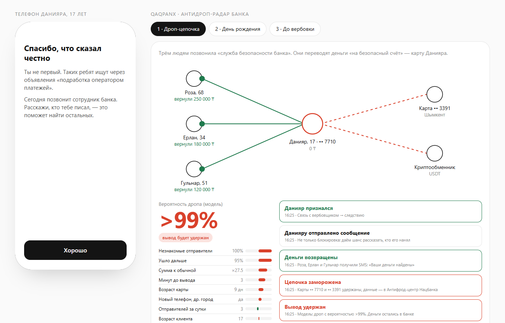
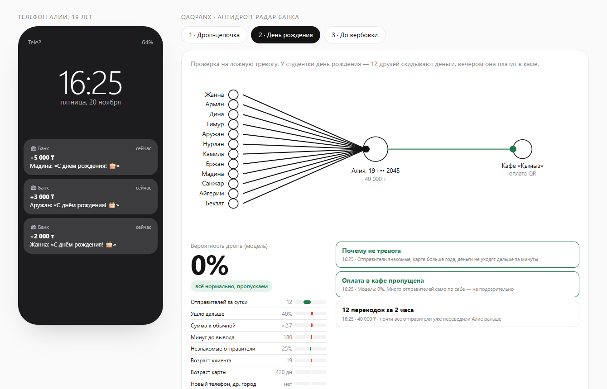

<div align="center">

# QaqpanX

Антидроп-радар для банка. Находит карты-«дропы», через которые мошенники выводят украденные деньги, и удерживает вывод, пока деньги ещё не ушли дальше.

[Открыть демо](https://qaqpanx.netlify.app) · [Слайды](https://qaqpanx.netlify.app/slides.html)


</div>

## Демо

<table>
<tr>
<td width="50%"></td>
<td width="50%"></td>
</tr>
<tr>
<td align="center"><sub>Дроп: незнакомые отправители и мгновенный вывод</sub></td>
<td align="center"><sub>Честный клиент: друзья скинулись на день рождения</sub></td>
</tr>
</table>

Слева телефон клиента с уведомлениями банка, справа экран аналитика. После каждого перевода модель пересчитывает, с какой вероятностью карта работает как дроп. Если вероятность выше 80%, вывод удерживается, а аналитик может заморозить всю цепочку и вернуть деньги отправителям.

В демо три сценария: дроп-цепочка, день рождения студентки и попытка завербовать подростка.

## Как работает модель

Модель оценивает счёт по восьми признакам:

| Признак | Что показывает |
|---|---|
| Возраст карты | Дропы чаще пользуются картами, открытыми на днях |
| Отправителей за сутки | Сколько разных людей прислали деньги |
| Доля незнакомых отправителей | Сколько из них раньше клиенту не переводили |
| Минут до вывода | Как быстро деньги уходят дальше |
| Доля ушедших дальше | Какая часть пришедшего сразу выведена |
| Новый телефон в другом городе | Был ли вход с незнакомого устройства |
| Возраст клиента | Подростков вербуют чаще остальных |
| Сумма к обычной | Во сколько раз сумма больше привычной для клиента |

На 3 000 тестовых счетах, которых модель не видела при обучении, она находит 93% дропов. Ложная тревога срабатывает у 0,8% честных клиентов.

В обучающие данные мы специально добавили честных клиентов, похожих на дропов: день рождения, продажи на OLX, новые карты, переводы между своими счетами. Добавили и «осторожных» дропов, которые маскируются под обычных клиентов.

## Структура

```
index.html       демо: телефон клиента + радар аналитика (без зависимостей)
slides.html      презентация
model/
  train.py       генерация синтетических данных и обучение модели
  dataset.csv    10 000 синтетических счетов (3% дропов)
  model.json     веса модели, они же вшиты в index.html
```

## Запуск

Чтобы посмотреть демо, откройте `index.html` в браузере.

Обучать модель заново не нужно, готовые веса лежат в `model/model.json`. Если хотите проверить обучение сами:

```bash
pip install numpy scikit-learn
cd model
python train.py
```

Данные синтетические: реальных банковских данных в проекте нет.
